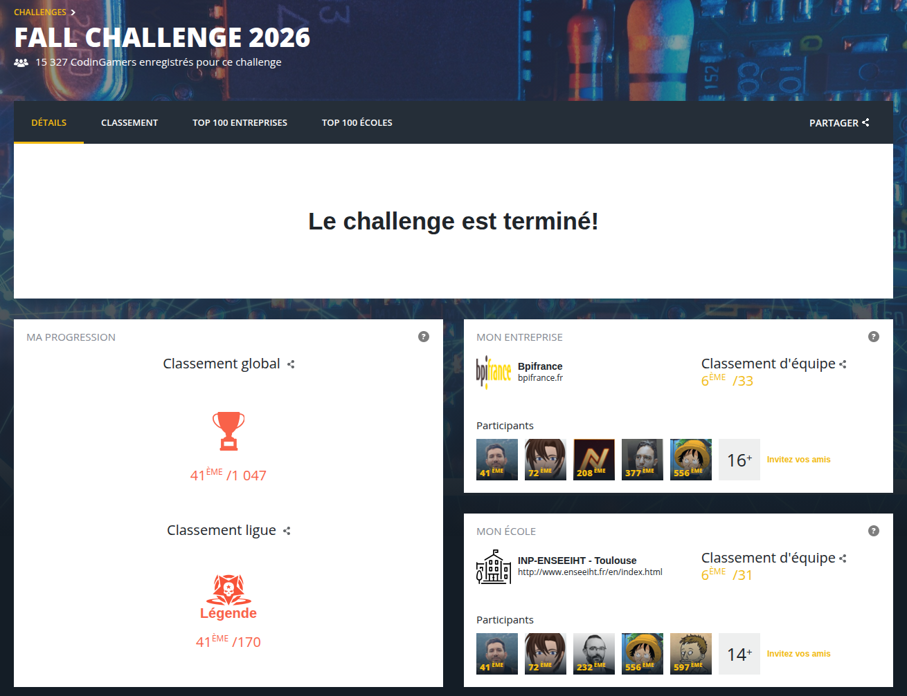
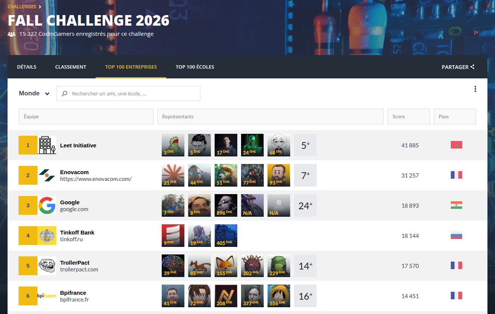
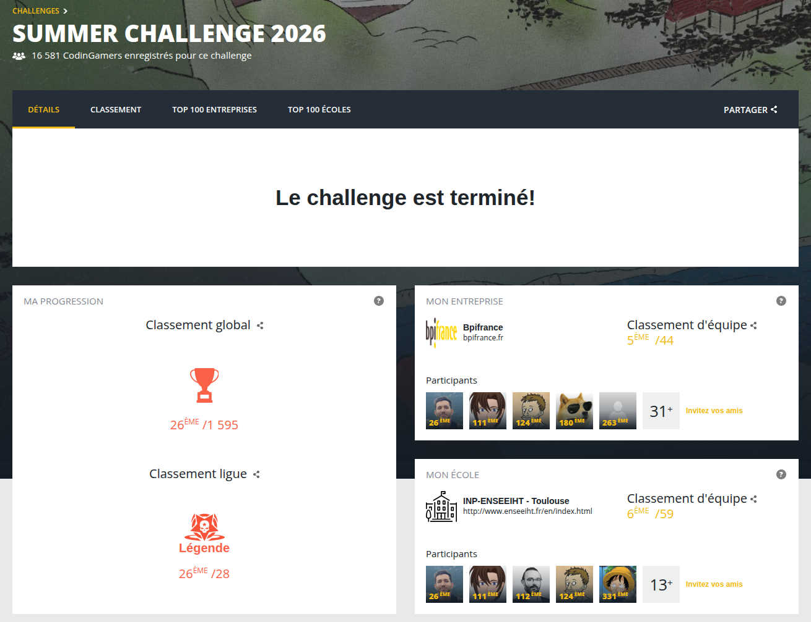
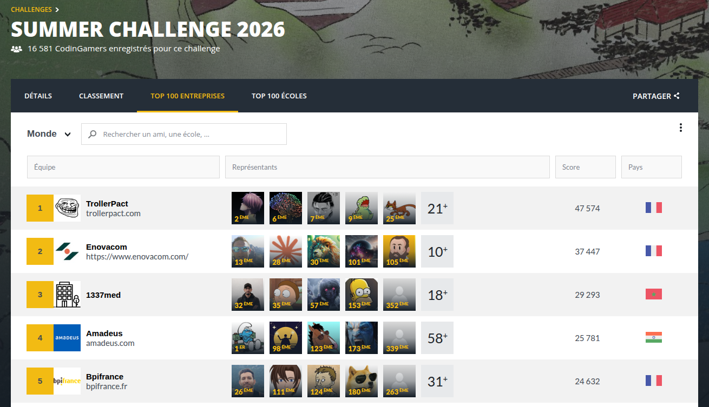
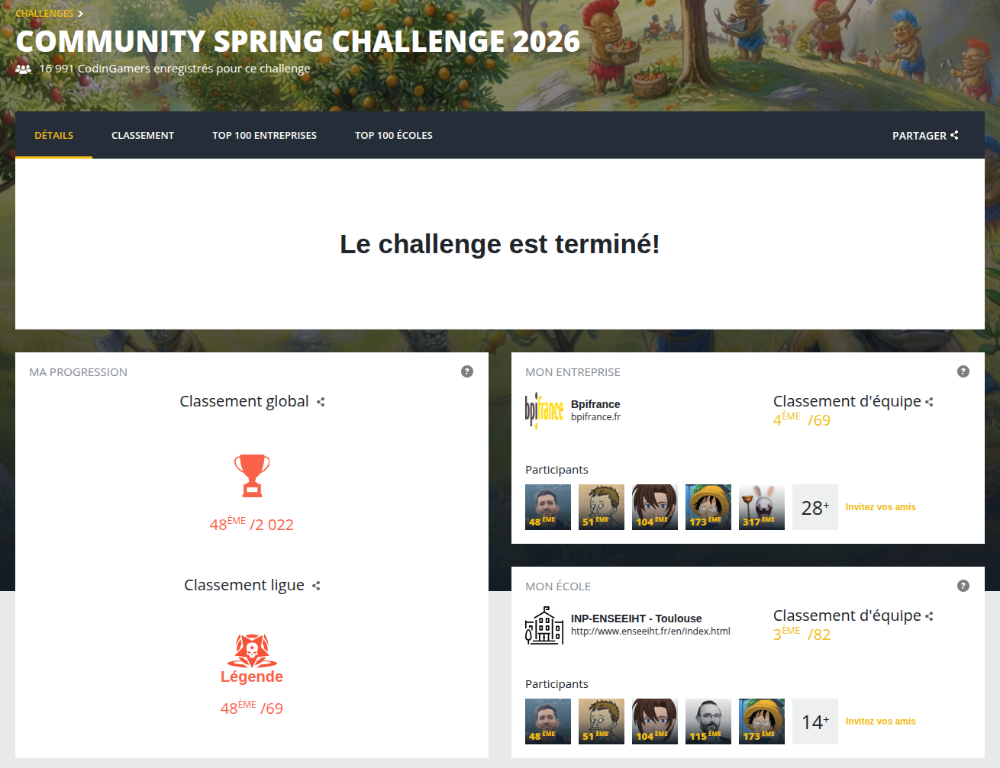
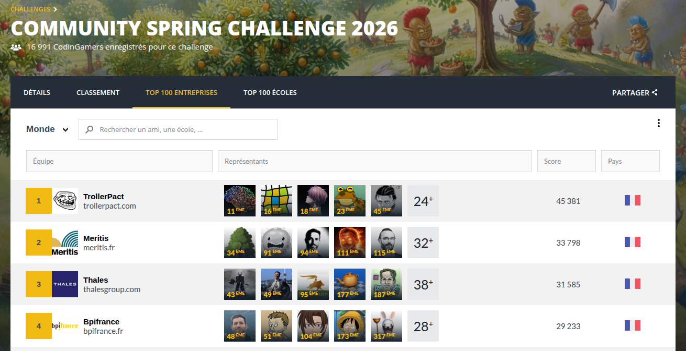

# Programmation de bots sur CodinGame

[English](README.md) | **Français**

Ce dépôt garde la trace de mes résultats et des versions successives de mes bots aux concours de programmation de bots de CodinGame.

Dans ces concours, chaque joueur écrit un programme qui joue seul à un jeu, contre les programmes des autres joueurs. Un concours dure une à deux semaines. Le classement vient de parties jouées automatiquement entre les bots, et les joueurs montent de ligue en ligue jusqu'à Legend, la plus haute. Un bot doit tenir dans un seul fichier source d'au plus 100 000 caractères et, dans ces trois jeux, il a 50 ms pour répondre à chaque tour.

## Résultats

Trois concours en 2026, tous terminés en ligue Legend. Ce sont les classements finaux de CodinGame. Pour l'entreprise et l'école, c'est le rang de l'équipe parmi toutes les entreprises ou écoles classées.

### [TryAngle Catch — Fall Challenge 2026](fall-challenge-2026-tryangle-catch/README.fr.md)

| Classement global | Classement ligue | Bpifrance (entreprise) | INP-ENSEEIHT (école) |
|:---:|:---:|:---:|:---:|
| **41e** / 1 047 | Legend, **41e** / 170 | **6e** / 33 | **6e** / 31 |

Du 2 au 9 novembre 2026. Bot final en C++ : un réseau de neurones sur graphe appris par imitation, et une recherche sur un tour avec un simulateur exact.

### [Back Track King — Summer Challenge 2026](summer-challenge-2026-back-track-king/README.fr.md)

| Classement global | Classement ligue | Bpifrance (entreprise) | INP-ENSEEIHT (école) |
|:---:|:---:|:---:|:---:|
| **26e** / 1 595 | Legend, **26e** / 28 | **5e** / 44 | **6e** / 59 |

Du 7 au 21 septembre 2026. Bot final en C++ : deux réseaux de neurones de ma conception, appris par imitation.

### [Troll Farm — Spring Challenge 2026](spring-challenge-2026-troll-farm/README.fr.md)

| Classement global | Classement ligue | Bpifrance (entreprise) | INP-ENSEEIHT (école) |
|:---:|:---:|:---:|:---:|
| **48e** / 2 022 | Legend, **48e** / 69 | **4e** / 69 | **3e** / 82 |

Du 12 au 25 mai 2026. Bot final en Java : des règles écrites à la main et des estimations économiques, en quatre phases.

## Le contenu de chaque page

Chaque concours a sa page, en anglais et en français, avec les mêmes sections :

| Section | Ce qu'on y trouve |
|---|---|
| Le jeu | Les règles en quelques lignes |
| Le bot final en bref | Ce que fait le bot à chaque tour |
| Chronologie | Les grandes versions du bot et la ligue atteinte par chacune |
| Les versions du bot | L'idée de chaque version et ce qu'elle a changé |
| Ce qui n'a pas marché | Les idées essayées puis abandonnées, et pourquoi |
| Où est la limite | Ce qui limite le bot final |
| Les outils | Les outils construits pour tester et améliorer le bot |
| Ce que j'ai appris | Les leçons que je garde pour les prochains concours |

J'ajoute une page après chaque nouveau concours.
