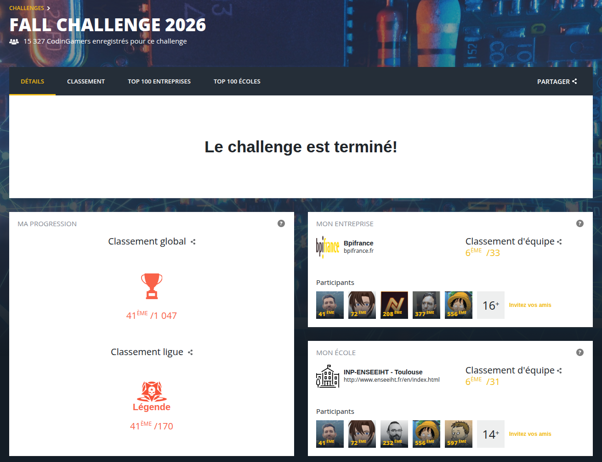
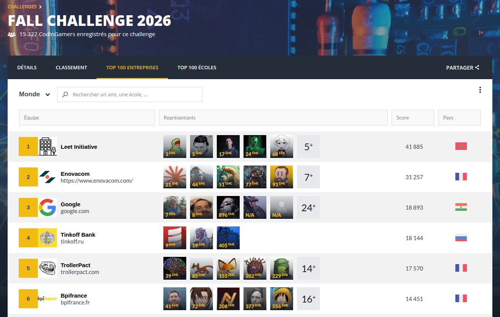
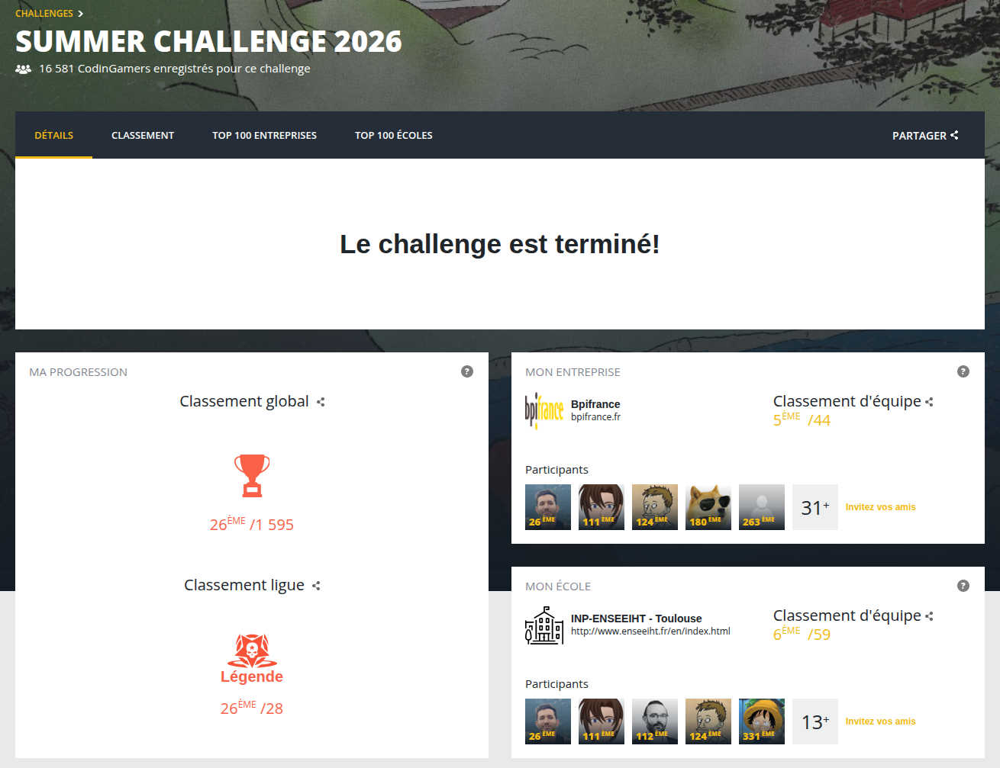
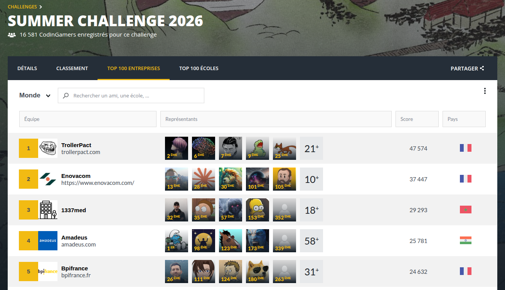
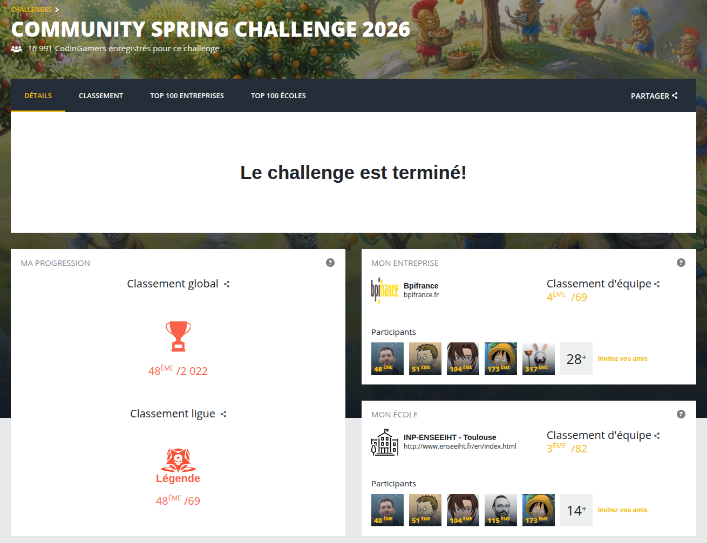
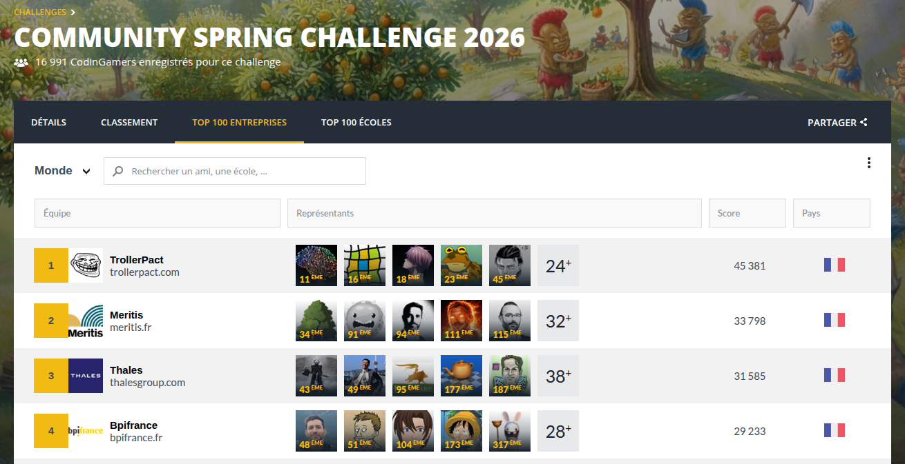

# CodinGame Bot Programming

**English** | [Français](README.fr.md)

This repository records my results and the successive versions of my bots in CodinGame bot programming contests.

In these contests, each player writes a program that plays a game on its own, against the programs of the other players. A contest lasts one to two weeks. The ranking comes from games played automatically between the bots, and players move up league by league to Legend, the top league. A bot must fit in a single source file of at most 100,000 characters, and in these three games it has 50 ms to answer each turn.

## Results

Three contests in 2026, all finished in the Legend league. These are the final CodinGame rankings. For the company and the school, the rank is the team's rank among all ranked companies or schools.

### [TryAngle Catch — Fall Challenge 2026](fall-challenge-2026-tryangle-catch/README.md)

| Global rank | League rank | Bpifrance (company) | INP-ENSEEIHT (school) |
|:---:|:---:|:---:|:---:|
| **41st** / 1,047 | Legend, **41st** / 170 | **6th** / 33 | **6th** / 31 |

November 2–9, 2026. Final bot in C++: a graph neural network trained by imitation, plus a one-turn search with an exact simulator.

### [Back Track King — Summer Challenge 2026](summer-challenge-2026-back-track-king/README.md)

| Global rank | League rank | Bpifrance (company) | INP-ENSEEIHT (school) |
|:---:|:---:|:---:|:---:|
| **26th** / 1,595 | Legend, **26th** / 28 | **5th** / 44 | **6th** / 59 |

September 7–21, 2026. Final bot in C++: two neural networks of my own design, trained by imitation.

### [Troll Farm — Spring Challenge 2026](spring-challenge-2026-troll-farm/README.md)

| Global rank | League rank | Bpifrance (company) | INP-ENSEEIHT (school) |
|:---:|:---:|:---:|:---:|
| **48th** / 2,022 | Legend, **48th** / 69 | **4th** / 69 | **3rd** / 82 |

May 12–25, 2026. Final bot in Java: hand-written rules and economic estimates, in four phases.

## Inside each contest page

Each contest has its own page, in English and in French, with the same sections:

| Section | What it covers |
|---|---|
| The game | The rules in a few lines |
| The final bot in brief | What the bot does each turn |
| Timeline | The main versions of the bot and the league each one reached |
| Bot versions | The idea behind each version and what it changed |
| What didn't work | The ideas I tried and dropped, and why |
| Where the limit is | What holds the final bot back |
| Tooling | The tools I built to test and improve the bot |
| What I learned | The lessons I keep for the next contests |

I add a page after each new contest.
